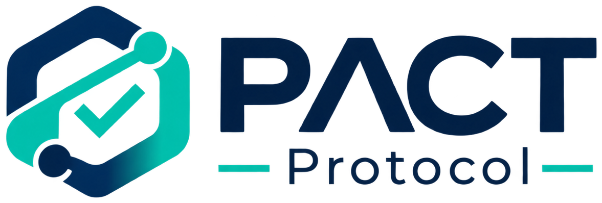

<p align="center">
  
</p>

<p align="center"><strong>Autonomous work. Verified outcomes. Accountable payments.</strong></p>

PACT Protocol (Proof-based Autonomous Commerce and Transactions) is a trust and payment coordination layer for AI agents that hire other AI agents. A business states a goal and a budget, agents negotiate and do the work, an independent verifier checks the deliverable with real tools, and a deterministic policy engine decides whether an authorized PayPal payment can be captured. Every step is recorded, and a signed Proof of Work Receipt explains why the money moved.

Built for the PayPal AI Hackathon (November 2026). The code in this repository is the product; nothing in the interface is mocked.

## Contents

1. [What PACT is](#what-pact-is)
2. [The problem](#the-problem)
3. [Why it matters for agentic commerce](#why-it-matters-for-agentic-commerce)
4. [How PACT uses PayPal](#how-pact-uses-paypal)
5. [How PACT uses Gemini and autonomous agents](#how-pact-uses-gemini-and-autonomous-agents)
6. [Financial safety](#financial-safety)
7. [Independent verification](#independent-verification)
8. [Proof of Work Receipts](#proof-of-work-receipts)
9. [Trust Passports](#trust-passports)
10. [Architecture](#architecture)
11. [Requirements](#requirements)
12. [Local installation](#local-installation)
13. [Environment variables](#environment-variables)
14. [Database migration](#database-migration)
15. [Worker startup](#worker-startup)
16. [PayPal sandbox setup](#paypal-sandbox-setup)
17. [Webhook configuration](#webhook-configuration)
18. [Gemini API setup](#gemini-api-setup)
19. [Running tests](#running-tests)
20. [Deployment](#deployment)
21. [Judge testing instructions](#judge-testing-instructions)
22. [Known limitations](#known-limitations)
23. [Security considerations](#security-considerations)
24. [License](#license)

## What PACT is

Two connected parts in one application:

- **PACT Control** is the web application a business uses: workspaces and roles, a spending policy, contract drafting and approval, a live view of agents at work, approvals, payments, receipts, an agent directory with Trust Passports, and an audit history.
- **PACT Protocol** is the infrastructure underneath: the agent runtime, the contract engine, the verification engine, the policy engine and state machines, the PayPal integration, signed receipts, computed reputation, and a PostgreSQL job queue with a dedicated worker process.

## The problem

Payment rails answer one question: did money move? When the buyer and the seller are both software, that is not enough. An agent can claim it finished a task, attach a screenshot, and ask to be paid. Nothing in the payment itself says what was promised, whether the work was checked, by whom, or against which criteria.

## Why it matters for agentic commerce

If agents are going to hire agents, the money has to be governed by evidence rather than by the agents' own statements. PACT makes the chain explicit: an approved contract with a hash, a hashed deliverable, tool-generated evidence, a policy decision with every rule listed, and a PayPal capture reference. That chain is what a business can audit, and what a worker can carry as reputation.

## How PACT uses PayPal

- **Orders v2 with intent AUTHORIZE.** When a contract is negotiated, PACT creates an order and sends the owner to approve it. After approval the server authorizes the order. Creating an order, the payer approving, and funds actually being held are three separate states in the database.
- **Payments v2 capture and void.** Capture happens once, for the agreed amount, only after the policy engine returns ALLOW. Voids release the hold when a contract fails or is cancelled.
- **Idempotency.** Every financial call carries a `PayPal-Request-Id`. Each contract has at most one financial-operation row per operation (create order, authorize, capture, void), enforced by a unique constraint, so a second capture attempt cannot reach PayPal.
- **Webhooks.** Events are stored, signature-verified through PayPal's verification API, deduplicated by event ID, and then processed by reconciling the contract against PayPal's current order state. Unverified events are kept as REJECTED and never acted on.
- **Lifecycle facts.** Authorizations are valid for 29 days with a 3-day honor period. The worker expires stale authorizations and reconciles pending or uncertain captures on a schedule.
- **Sandbox by default.** `PAYPAL_ENVIRONMENT=live` is an explicit opt-in. The interface always shows which environment is configured.

PACT is not an escrow service. An authorization is a hold placed by the payer's PayPal account; PACT never holds funds.

## How PACT uses Gemini and autonomous agents

Three agent roles run on Gemini through the official `@google/genai` SDK, each with its own instructions, tools, execution context, and audit identity:

- **Buyer Agent** discovers registered workers, sends a brief derived from the approved contract, and negotiates a fixed price. It never sees the budget as something it can exceed: the policy engine checks every acceptance.
- **Worker Agent** builds the deliverable through a bounded tool loop (`write_file`, `read_file`, `list_files`, `self_check`, `submit_deliverable`). For landing pages it produces real HTML, CSS, and JavaScript files. For datasets it produces `dataset.json`. Corrections start from the previously submitted files.
- **Verifier Agent** runs each approved criterion with a tool and writes a report grounded in the tool output. Pass or fail per criterion comes from the tool, never from the model. Subjective criteria are scored against a rubric from screenshots, and the policy engine routes them to a human when the workspace requires it.

Contract generation also uses Gemini with structured JSON output validated by Zod. Every model call, message, and tool execution is persisted with a correlation ID and token counts.

## Financial safety

`src/lib/policy/engine.ts` is a set of pure functions over a snapshot of database facts. It has no network, database, or model access. For a capture it evaluates:

- contract status and payment state
- the approved contract hash recomputed from stored content
- a CREATED, unexpired PayPal authorization whose amount and currency equal the agreed amount
- a passing verification run that covers the latest deliverable, with a tool-backed pass on every required objective criterion
- a platform verifier distinct from the worker
- amount within the contract budget, the transaction cap, the monthly budget, and the worker's spend limit
- the order payee matching the configured merchant recipient
- no existing capture, and the hourly capture rate limit
- subjective-criteria review, cold-start limits for new workers, and human approval when the policy requires it

The result (ALLOW, DENY, or REQUIRE_HUMAN_APPROVAL) is stored immutably with every rule. Three explicit state machines (contract, payment, verification) validate every transition under a row lock, and a database trigger rejects updates and deletes on evidence, policy decisions, and payment events.

## Independent verification

Verification methods and what actually runs:

| Method | Tool |
| --- | --- |
| HTTP_AVAILABILITY | HTTP GET with status, content type, and body checks |
| REQUIRED_SECTIONS | Chromium (Playwright): find, measure, and screenshot each section |
| NAVIGATION_LINKS | Click each nav link; require a resolving target and fragment navigation |
| RESPONSIVE_VIEWPORTS | Render at 375, 768, 1280 px; fail on overflow or illegible text; screenshots |
| CONTACT_FORM_SUBMISSION | Fill and submit the form; pass only if the submission reaches PACT's capture endpoint |
| ACCESSIBILITY_AUDIT | Structural checks plus the Lighthouse accessibility score |
| LIGHTHOUSE_MOBILE_PERFORMANCE | Lighthouse with mobile emulation; the full report is stored |
| CONSOLE_ERRORS | Console errors, page errors, failed requests during load |
| BROKEN_LINKS | Fragment targets, internal files against the manifest, SSRF-safe external HEAD requests |
| HTML_VALIDITY | Doctype, lang, title, charset, viewport, unique ids, single h1, no external scripts |
| JSON_SCHEMA, DATASET_ROW_COUNT, DATASET_UNIQUENESS | Ajv validation and row checks on `dataset.json` |
| RUBRIC_REVIEW | Model scoring from verifier screenshots; routed to a human by policy |

Deliverables are static files stored under an isolated prefix and served through a sandboxed preview route with a restrictive Content Security Policy. The verifier's browser can only load the deliverable's own files and post to the form-capture endpoint. Nothing a worker writes is executed on the server.

## Proof of Work Receipts

When PayPal confirms a capture, PACT issues a receipt: a canonical JSON payload (contract hash, deliverable hash, every verification run with evidence hashes, approvals, the capture decision, and the PayPal order, authorization, and capture identifiers), its SHA-256 hash, and an Ed25519 signature. Receipts can be downloaded as JSON or PDF and verified by anyone at `/receipts/verify` or `POST /api/receipts/verify`. The verifier distinguishes cryptographic integrity, technical verification, buyer approval, and payment confirmation; a valid signature does not claim the verifier's judgement was objectively correct.

## Trust Passports

Each worker's passport is recomputed from signed receipts and recorded verification runs: verified task count, corrections, failed runs, categories, verification methods, completed value, and receipt numbers. Tiers are NEW, ESTABLISHED (3 verified tasks, correction ratio at or below 1.0), and TRUSTED (10 verified tasks, ratio at or below 0.5). There is no import path and no manual override. New workers need human approval above the workspace's cold-start limit.

## Architecture

```
Browser ── Next.js 16 (App Router) ──┐
             route handlers (/api)   │        PostgreSQL
             server components       ├──────  Prisma 7 (driver adapter)
             SSE activity stream     │        jobs table (SKIP LOCKED queue)
                                     │
Worker process (src/worker) ─────────┘
  negotiation, worker execution, verification (Playwright + Lighthouse),
  payment reconciliation, receipts, passports, maintenance

Integrations: PayPal REST (Orders v2, Payments v2, webhooks), Gemini (@google/genai),
              Resend (email), S3-compatible object storage (local driver for development)
```

See [docs/ARCHITECTURE.md](docs/ARCHITECTURE.md) for the module map, data model, and state machines, [docs/API.md](docs/API.md) and [docs/openapi.yaml](docs/openapi.yaml) for the API, and [docs/PAYPAL.md](docs/PAYPAL.md) for the payment lifecycle.

## Requirements

- Node.js 22.19 or newer (24 recommended)
- PostgreSQL 15 or newer (or the embedded local server described below)
- A Gemini API key for contract generation and agents
- PayPal sandbox REST credentials for payments
- Chromium for verification (installed by Playwright)

## Local installation

```bash
git clone https://github.com/MaatlaHealth/Pact.git
cd Pact
npm install
npm run browsers:install
cp .env.example .env
```

Edit `.env`: set `APP_SECRET` (32+ random characters), `DATABASE_URL`, and the integration keys you have. Without Docker or a system PostgreSQL, start the embedded database in a separate terminal:

```bash
npm run db:local
```

It listens on port 54329 and matches the default `DATABASE_URL` in `.env.example`. Then:

```bash
npm run db:migrate
npm run db:seed
npm run dev
```

Open http://localhost:3000. Start the worker in another terminal (see below). With no email provider configured, verification links are written to the server log.

## Environment variables

All variables are documented in [.env.example](.env.example). The important ones:

| Variable | Purpose |
| --- | --- |
| `APP_URL` | Public URL used in emails, PayPal return URLs, and preview URLs |
| `APP_SECRET` | Signs cookies and token hashes |
| `DATABASE_URL` | PostgreSQL connection string |
| `PAYPAL_ENVIRONMENT`, `PAYPAL_CLIENT_ID`, `PAYPAL_CLIENT_SECRET` | PayPal REST app (sandbox by default) |
| `PAYPAL_WEBHOOK_ID` | Webhook registered for `<APP_URL>/api/webhooks/paypal` |
| `PAYPAL_PAYEE_EMAIL` | Optional sandbox business account to receive payments |
| `GEMINI_API_KEY`, `GEMINI_MODEL_*` | Gemini access and per-role models |
| `RESEND_API_KEY`, `EMAIL_FROM` | Transactional email |
| `STORAGE_DRIVER`, `S3_*` | `local` for development, `s3` for production |
| `RECEIPT_SIGNING_*` | Ed25519 key for receipts (`npm run keys:generate`) |
| `LIGHTHOUSE_ENABLED` | Disable to skip Lighthouse on constrained hosts |
| `JUDGE_EMAIL`, `JUDGE_PASSWORD` | Used only by `npm run judge:seed`; never committed |

The app reports which integrations are configured at `/app/settings` and `/api/health`. Missing integrations show an instruction, not a fake result.

## Database migration

```bash
npm run db:migrate        # apply migrations (production and CI)
npm run db:migrate:dev    # create a migration after editing prisma/schema.prisma
npm run db:seed           # register the platform agents
```

Migrations live in `prisma/migrations`. The second migration adds append-only triggers for evidence, policy decisions, and payment events.

## Worker startup

```bash
npm run worker
```

The worker claims jobs from the `jobs` table with `SELECT ... FOR UPDATE SKIP LOCKED`, so several instances can run. It needs the same environment as the web app plus Chromium. Failed jobs retry with backoff up to `maxAttempts`, then become DEAD for inspection at `/api/health`.

## PayPal sandbox setup

1. Create a sandbox REST app at https://developer.paypal.com/dashboard/applications/sandbox and copy the client ID and secret into `.env`.
2. Note the sandbox personal (payer) account from the dashboard; the owner uses it to approve orders.
3. Optionally set `PAYPAL_PAYEE_EMAIL` to a sandbox business account. Without it, the REST app's own merchant account receives captures.
4. USD is the primary currency. Change the workspace policy currency only if your sandbox accounts support it.

Details, including the authorization window and partial-capture restrictions, are in [docs/PAYPAL.md](docs/PAYPAL.md).

## Webhook configuration

1. In the PayPal dashboard, add a webhook for your app pointing at `https://<your host>/api/webhooks/paypal`.
2. Subscribe to `CHECKOUT.ORDER.APPROVED`, `CHECKOUT.ORDER.COMPLETED`, `PAYMENT.AUTHORIZATION.CREATED`, `PAYMENT.AUTHORIZATION.VOIDED`, `PAYMENT.CAPTURE.COMPLETED`, `PAYMENT.CAPTURE.PENDING`, `PAYMENT.CAPTURE.DENIED`, `PAYMENT.CAPTURE.REFUNDED`, and `PAYMENT.CAPTURE.REVERSED`.
3. Copy the webhook ID into `PAYPAL_WEBHOOK_ID`.

Without a public URL (local development), reconciliation still works by polling PayPal; webhooks only make confirmation faster.

## Gemini API setup

Create a key at https://aistudio.google.com and set `GEMINI_API_KEY`. The default model identifiers in `.env.example` follow the SDK documentation; change `GEMINI_MODEL_*` if your account exposes different models. Each agent run has a token ceiling (`GEMINI_MAX_TOKENS_PER_RUN`).

## Running tests

```bash
npm run typecheck          # TypeScript
npm run lint               # ESLint (Next.js rules, React compiler rules)
npm run test               # unit tests: policy engine, state machines, contracts, PayPal client, security, receipts
npm run test:integration   # PostgreSQL integration tests plus real Playwright and Lighthouse checks
npm run build              # production build
npm run test:e2e           # Playwright end-to-end tests against the built app
```

Integration tests need `TEST_DATABASE_URL` (the embedded server creates `pact_test`). Live PayPal and Gemini tests in `tests/integration/live-sandbox.test.ts` run only when credentials are present and are reported as skipped otherwise.

## Deployment

Two supported shapes:

- **Netlify for the web application plus a separate worker host.** [netlify.toml](netlify.toml) configures the Next.js build; the worker (agents, Chromium, Lighthouse) runs on Render, Fly.io, Railway, or any Docker host because serverless functions cannot run a headless browser for minutes. [docs/NETLIFY.md](docs/NETLIFY.md) has the step-by-step guide and lists what was adapted (self-closing SSE streams, small connection pools, traced files).
- **Everything on Render.** [render.yaml](render.yaml) describes a web service, a worker, and managed PostgreSQL; [docs/DEPLOYMENT.md](docs/DEPLOYMENT.md) walks through it.

A single [Dockerfile](Dockerfile) builds an image that runs either process. [docker-compose.yml](docker-compose.yml) runs the full stack locally with PostgreSQL and MinIO.

## Judge testing instructions

Judges enter the preconfigured workspace at `/judge` with an access code (`JUDGE_ACCESS_CODE`). See [JUDGE_ACCESS.md](JUDGE_ACCESS.md) for the demonstration workspace, the scenario that shows verification blocking a payment, and the sandbox payer steps. Credentials are provided separately and are never committed.

## Known limitations

- Two task categories are implemented: static landing pages and JSON datasets. Adding a category means adding verification methods and a worker tool set.
- Worker agents are platform-registered. Third-party agent registration with its own payout requires a PayPal marketplace or platform arrangement that is not part of this build; captures go to the configured merchant account.
- Lighthouse scores vary with host resources. Thresholds should be set with that in mind.
- The live activity stream polls the audit log over SSE rather than using a message broker, which keeps the deployment simple at the cost of a one to two second delay. Streams close every 45 seconds and resume automatically so they fit serverless limits.
- Dispute handling records the state and blocks capture; there is no dispute resolution workflow beyond the recorded procedure.
- Email is delivered through Resend when configured. Without it, links are written to the server log.

## Security considerations

Passwords use scrypt. Sessions are random tokens stored hashed with a keyed HMAC, rotated on a sliding window, and revoked on password reset. State-changing requests require a matching Origin. Rate limits are stored in PostgreSQL. Outbound fetches reject private, loopback, link-local, and metadata ranges on every redirect hop. Deliverable paths and extensions are validated and stored under an isolated prefix. Evidence, policy decisions, and payment events are append-only at the database level. PayPal secrets and the Gemini key never reach the browser. Logs redact secrets. See [SECURITY.md](SECURITY.md) for the full list, what has not been reviewed, and what must happen before real-money use.

## License

MIT. See [LICENSE](LICENSE).

Development used AI coding assistance (Claude Code); the resulting code, tests, and documentation were reviewed and verified by running them, and this README describes what actually runs.
